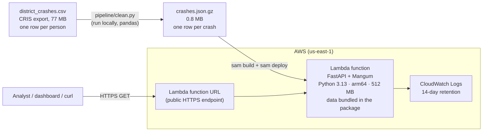
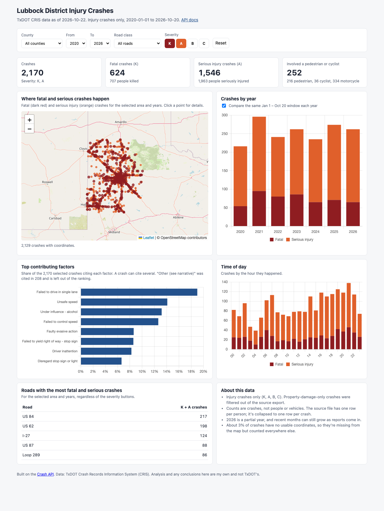

# Lubbock District Crash API

A small data app built on TxDOT CRIS crash records for the Lubbock district (2020 to October 2026). It cleans the raw export, serves crash statistics through a REST API, and runs on AWS Lambda inside the free tier. There's also a one-page dashboard for a traffic safety analyst.

- **Live dashboard:** https://xsem5fdq5uie7i4va6kwcwl6la0vijfx.lambda-url.us-east-1.on.aws/
- **API docs (interactive):** https://xsem5fdq5uie7i4va6kwcwl6la0vijfx.lambda-url.us-east-1.on.aws/docs
- **Try it:** https://xsem5fdq5uie7i4va6kwcwl6la0vijfx.lambda-url.us-east-1.on.aws/api/factors?severity=KA&county=Lubbock
- **EDA and cleaning notes:** [`notebooks/eda.ipynb`](notebooks/eda.ipynb)

## The short version

The raw file looks like a crash table, but it's actually **one row per person**: 67,906 rows for 24,261 crashes. Most of the work was getting back to one row per crash and handling the messy fields properly. Then I put a small API in front of it and deployed it as a single Lambda function, with a function URL.

| | |
|---|---|
| Crashes (injury only, K/A/B/C) | 24,261, matching TxDOT's own count in the file header |
| Fatal (K) / serious injury (A) | 624 / 1,546 |
| Top contributing factor | Failed to control speed (5,559 crashes) |
| Top factor in fatal + serious crashes | Failed to drive in single lane |
| Road with the most fatal + serious crashes | US 84 (Loop 289 has the most crashes overall) |
| Fatal + serious crashes, Jan 1 to Oct 20 | 262 in 2026 vs 274 in 2025 (peak: 296 in 2021) |

## Project layout

```
pipeline/clean.py          reads the raw CSV, cleans it, writes one row per crash
src/crash_api/
    main.py                FastAPI app (endpoints, filters, Lambda handler)
    metrics.py             the actual calculations (severity, factors, trends, summary)
    schemas.py             response models, so /docs shows what each endpoint returns
    data.py                loads the cleaned file and applies filters
    static/index.html      the dashboard
    data/crashes.json.gz   cleaned data (~0.8 MB), shipped with the function
notebooks/eda.ipynb        exploration, data quality issues, cleaning decisions
tests/                     pytest suite (90 tests)
template.yaml              AWS SAM template (infrastructure as code)
```

## Running it locally

You need Python 3.12+ (I used 3.13).

```bash
python -m venv .venv
source .venv/bin/activate
pip install -r requirements.txt

# 1. Clean the data (the raw CSV isn't in the repo, see below)
cp /path/to/district_crashes.csv data/raw/
python -m pipeline.clean

# 2. Run the API and dashboard
uvicorn crash_api.main:app --app-dir src --reload
#  -> dashboard: http://localhost:8000
#  -> API docs:  http://localhost:8000/docs

# 3. Tests
pytest
```

Step 1 is optional. The cleaned file is already committed in `src/crash_api/data/`, so the API runs straight after `pip install`. The pipeline prints its reconciliation against TxDOT's counts and the three required metrics:

```
 crashes: ours=24,261  txdot=24,261  ok
 persons: ours=67,906  txdot=67,906  ok

Crashes by severity
  K  Fatal                         624  2.6%
  A  Suspected serious injury    1,546  6.4%
  B  Suspected minor injury      7,224  29.8%
  C  Possible injury            14,867  61.3%

Top 5 contributing factors (crashes citing each)
   5,559  FAILED TO CONTROL SPEED
   2,428  FAILED TO YIELD RIGHT OF WAY - STOP SIGN
   2,346  FAILED TO YIELD RIGHT OF WAY - TURNING LEFT
   2,334  FAILED TO DRIVE IN SINGLE LANE
   2,034  UNSAFE SPEED
...
```

**Environment variables:** none are required. `CRASH_DATA_PATH` can point the API at a different cleaned file if you want one.

**Why the raw CSV isn't committed:** it's 77 MB, and it carries person-level details (age, gender, ethnicity, driver ZIP code). I don't think it's mine to republish, so `data/raw/` is git-ignored. The cleaned file only has crash-level fields.

## The data, briefly

The full reasoning is in the [notebook](notebooks/eda.ipynb). The decisions that matter most:

- **One row per crash.** The export repeats crash-level columns on every person row. The pipeline checks those columns really are identical within each crash (and fails if not), then keeps one row per `Crash ID`. Counting rows instead would overstate everything by about 2.8x.
- **Contributing factors** are split from the combined field, which uses both `;` and `; ` as separators. Each piece is trimmed and de-duplicated per crash. The metric is *crashes citing each factor*. `NONE` is dropped. `OTHER (EXPLAIN IN NARRATIVE)` is left out of the ranking by default, because the narrative isn't in the export, but the API still reports how many crashes cited it.
- **Missing values** come in at least seven spellings (`No Data`, `NO DATA`, `N/A`, `NOT REPORTED`, `-1`, `99 - UNKNOWN`, blanks). They're all mapped to null in one function.
- **Coordinates:** 849 crashes (3.5%) have none. They stay in every count but can't go on the map.
- **2026 is a partial year** (data ends Oct 20). I didn't annualise it. The API flags incomplete periods and offers a same-period comparison instead.
- **No property-damage-only crashes.** The export was filtered to K/A/B/C, so every number here means injury crashes.

## API

Every `/api` endpoint takes the same filters and returns the same envelope. A dashboard can wire up one set of controls and reuse them everywhere.

**Shared filters** (all optional, case-insensitive):

| Parameter | Example | Notes |
|---|---|---|
| `county` | `Lubbock` or `Lubbock,Hale` | Repeat or comma-separate. Unknown names return a 400 listing valid ones. |
| `severity` | `K`, `KA`, `B,C` | Any mix of K, A, B, C. `KA` = fatal + serious, the usual safety focus. |
| `year_from`, `year_to` | `2023` | Inclusive. |
| `road_class` | `City Street`, `Interstate` | Valid values are in `/api/meta`. |

**Endpoints:**

| Endpoint | What it's for | Extra parameters |
|---|---|---|
| `GET /api/meta` | Dataset info, data freshness, and valid filter values (for dropdowns) | |
| `GET /api/summary` | Headline numbers: crashes, K, A, deaths, pedestrian/cyclist crashes, top roads for KA | |
| `GET /api/severity` | Crash counts and shares for K, A, B, C | |
| `GET /api/factors` | Top contributing factors | `n` (default 5), `include_unspecified` |
| `GET /api/trends` | Counts over time, split by severity | `by=year\|month\|hour\|weekday`, `same_period` (with `by=year` only) |
| `GET /api/crashes` | Individual crashes, newest first, for maps and tables | `limit` (max 5000), `offset`, `has_location` (`true` = mappable only, `false` = the 849 without coordinates) |

Example: what's behind fatal and serious crashes in Lubbock County?

```
GET /api/factors?county=Lubbock&severity=KA&n=3
```
```json
{
  "filters": {"county": ["Lubbock"], "severity": ["K", "A"], "year_from": null, "year_to": null, "road_class": null},
  "crash_count": 1035,
  "crashes_considered": 1035,
  "crashes_with_a_factor": 1030,
  "unspecified_excluded": {"OTHER (EXPLAIN IN NARRATIVE)": 86},
  "data": [
    {"rank": 1, "factor": "FAILED TO DRIVE IN SINGLE LANE", "crashes": 187, "share_of_crashes": 0.1807},
    {"rank": 2, "factor": "UNSAFE SPEED", "crashes": 159, "share_of_crashes": 0.1536},
    {"rank": 3, "factor": "UNDER INFLUENCE - ALCOHOL", "crashes": 151, "share_of_crashes": 0.1459}
  ]
}
```

Example: a fair year-over-year comparison, given that 2026 isn't over:

```
GET /api/trends?severity=KA&same_period=true&year_from=2024
```
```json
{
  "filters": {"county": null, "severity": ["K", "A"], "year_from": 2024, "year_to": null, "road_class": null},
  "crash_count": 771,
  "by": "year",
  "same_period": true,
  "notes": ["Each year counts Jan 1 to Oct 20 only."],
  "data": [
    {"period": 2024, "K": 65, "A": 170, "B": 0, "C": 0, "KA": 235, "total": 235},
    {"period": 2025, "K": 71, "A": 203, "B": 0, "C": 0, "KA": 274, "total": 274},
    {"period": 2026, "K": 65, "A": 197, "B": 0, "C": 0, "KA": 262, "total": 262}
  ]
}
```

A few design choices:

- **Same filters everywhere, same envelope everywhere.** `filters` echoes back what was actually applied after normalising, so `?county=lubbock` comes back as `["Lubbock"]`. `crash_count` is always the number of crashes behind the answer.
- **Bad input gets a useful error, never a quiet empty answer.** `?county=Lubock` returns a 400 with the list of valid counties. So does a misspelled parameter like `?countys=Hale`, which would otherwise be ignored and return district-wide numbers. A year range with no data at all (`?year_to=2019`) gets a 400 listing the years that exist.
- **One error shape.** Every error, including FastAPI's own type and range checks (422), comes back as `{"detail": {"message": ..., "valid_values" or "errors": ...}}`.
- **Typed responses.** Every endpoint has a Pydantic response model (`src/crash_api/schemas.py`), so `/docs` and `/openapi.json` show the exact shape of successful responses and both error types.
- **Shares use all crashes as the denominator**, including the 104 with no factor recorded. `/api/summary` reports `deaths` (people) next to `fatal_crashes` (crashes), and they differ because some crashes kill more than one person.
- **Trends always split by severity.** Most crashes happen at 5pm, but fatal and serious crashes are three times more likely at night. A total-only trend would hide that.
- **`/api/crashes` only returns crash-level fields.** No ages, genders, ethnicities or ZIP codes ever reach the public API.
- Responses are gzipped and sent with `Cache-Control: public, max-age=3600`, since the data only changes on redeploy.

## Deployment

### What's deployed



It's one Lambda function with a function URL, defined in [`template.yaml`](template.yaml) with AWS SAM.

**How data flows:**

1. **Offline:** `pipeline/clean.py` reads the 77 MB person-level CSV with pandas, cleans it and writes a 0.8 MB gzipped JSON file with one row per crash.
2. **Deploy:** `sam build` packages that file together with the API code and its two dependencies (FastAPI and Mangum, about 11 MB in total). `sam deploy` creates or updates the CloudFormation stack.
3. **Request:** a browser hits the function URL. Lambda runs the FastAPI app through Mangum, which translates the Lambda event into a normal HTTP request. On a container's first request, the data file loads into memory. After that, it stays cached for every later request that container handles.
4. **Response:** filtering and aggregation happen in plain Python over 24k records, and the response goes back as gzipped JSON.

What that looks like in CloudWatch on the deployed function:

| | |
|---|---|
| Cold start (Lambda init + first request, including loading the data) | about 2.4 s |
| Warm request | about 75 ms |
| Memory used | 134 MB of 512 MB |

Cold starts only happen after the function has been idle for a while. For a dashboard that's acceptable. If it weren't, provisioned concurrency would fix it, but that isn't free.

### Why this setup

The data is small, static and read-only, and the traffic is a few reviewers clicking around. So I wanted the fewest moving parts that still cost nothing when idle.

- **Lambda over a server (EC2):** no instance to patch, nothing running when nobody's using it, and Lambda's free allowance (1M requests and 400,000 GB-seconds a month) doesn't expire after 12 months the way EC2's free hours do. At 512 MB that's 800,000 seconds of compute a month, far more than this needs.
- **Function URL over API Gateway:** a function URL is a built-in HTTPS endpoint with no extra charge and no extra resource to configure. API Gateway would add throttling, API keys and custom domains. Those are useful, but none were needed here, and its free tier is only for the first 12 months.
- **Data bundled in the package, not in S3 or a database:** 0.8 MB is tiny. Reading it from the package means no S3 calls, no IAM permissions to grant, nothing extra to keep in sync, and the fastest cold start. A database (RDS or DynamoDB) would add cost and a network hop to answer questions that take milliseconds in memory.
- **pandas only offline:** pandas, NumPy and PyArrow are big and slow to import on a cold start. The cleaning happens once on my machine, so the deployed function needs nothing heavier than FastAPI.
- **FastAPI:** request validation and the interactive `/docs` page come for free, so reviewers can try every endpoint in the browser.
- **arm64 (Graviton):** about 20% cheaper per millisecond than x86 on Lambda, and the build pulls the right Linux ARM wheels automatically.
- **SAM:** the whole deployment is one template file, so anyone can recreate it with two commands, and `sam delete` tears it all down.

| Option I considered | Why I didn't use it |
|---|---|
| EC2 t2/t3.micro + Flask | Always on, needs patching, free for 12 months only. More to manage for no benefit at this traffic. |
| API Gateway + Lambda | Fine, but adds a resource. Its free tier ends after 12 months, and I didn't need its features. |
| App Runner / Elastic Beanstalk | Not free, or bring in load balancers and instances. |
| Data in S3, queried with Athena | Pays off with gigabytes of data or frequent updates, not 0.8 MB. |
| RDS / DynamoDB | Ongoing cost or capacity planning for a dataset that fits in memory. |

### Cost

Expected cost is **$0**:

- **Lambda:** the always-free monthly allowance covers millions of requests at this size.
- **Function URL:** no charge beyond the Lambda invocation.
- **CloudWatch Logs:** tiny, and log retention is set to 14 days so it doesn't pile up.
- **S3:** SAM keeps the deployment package (about 11 MB) in a bucket it manages. That's well inside the free allowance.
- **Budget alert:** pass `AlertEmail` at deploy time and the template creates an AWS Budget that emails you at the first cent of spend.

Note that AWS changed its free tier for accounts created after July 15, 2025, to a credit-based Free plan. Lambda's free allowance applies under both the old and new plans. It's still worth checking the Billing console once after deploying.

### Security

- **No credentials anywhere in the code.** SAM uses whatever AWS credentials are configured locally (an SSO profile or `aws configure`). Nothing is stored in the repo.
- **Least privilege:** SAM gives the function its default role, which can only write its own logs. It has no access to S3, databases or anything else.
- **Public, but read-only.** There's no write endpoint, and the only data exposed is crash-level fields. Person-level details never leave the pipeline.
- **CORS** is handled by FastAPI (GET only), not the function URL config. Setting it in both places sends duplicate headers, which browsers reject.

### Deploying it yourself

You need the [AWS SAM CLI](https://docs.aws.amazon.com/serverless-application-model/latest/developerguide/install-sam-cli.html), configured AWS credentials, and Python 3.13 locally (or Docker, with `sam build --use-container`).

```bash
sam build
sam deploy --parameter-overrides AlertEmail=you@example.com   # AlertEmail is optional
```

The stack prints `ApiUrl` when it finishes. That's the dashboard, with the docs at `/docs`. Defaults (stack name, region) are in `samconfig.toml`. To remove everything:

```bash
sam delete
```

SAM adds the two resource-policy statements a public function URL needs (`lambda:InvokeFunctionUrl` and `lambda:InvokeFunction`). If you ever get `403 Forbidden`, check those under Configuration, then Permissions, in the Lambda console.

To refresh the data: drop a new CRIS export into `data/raw/`, run `python -m pipeline.clean`, then `sam build && sam deploy`.

## Bonus: dashboard

The function also serves a single-page dashboard at `/`. It's plain HTML with Leaflet and Chart.js, and it calls the same public API endpoints as everyone else. That's also a good test that the API is actually usable.

I built it around what a safety analyst would look at first:

- **A map of fatal and serious crashes**, with a popup for each one (date, road, factors).
- **Year-over-year KA crashes**, defaulting to the fair Jan 1 to Oct 20 comparison, with a toggle to see full years.
- **Top factors and time of day**, both following the severity filter.
- **Roads ranked by fatal and serious crashes**, which tells a different story from the busiest roads.



It opens with the severity filter set to K and A, because that's where safety programs focus. Everything also works for B and C.

## Testing

```bash
pytest          # 90 tests, about 1 second
```

- **Cleaning:** header detection, the person-to-crash collapse, factor parsing (both separators, duplicates, `NONE`), missing-value tokens, coordinate bounds, road names, and failing loudly when a crash disagrees with itself. These run against a small hand-written CRIS-style file, so the expected answers are obvious.
- **Metrics:** counting crashes and not mentions, tie-breaking, gap filling in trends, partial-year flags, and the same-period window.
- **API:** the shared envelope, filters, validation errors, pagination, no personal fields in responses, and a simulated Lambda function URL event going through the Mangum handler.
- **Real data:** totals reconcile with TxDOT's header (24,261 crashes, 67,906 persons), Crash IDs are unique, and every fatal crash has a death.

## Limitations and what I'd do next

- **The data is a snapshot.** Updating it means re-running the pipeline and redeploying. With more time, I'd add a scheduled job that pulls a fresh CRIS export, cleans it and writes to S3, with the function reading from there.
- **No rate limiting.** The function URL is public, so someone could hammer it. The budget alert would catch any cost, and Lambda's account concurrency caps the blast radius. For real use, I'd put API Gateway with throttling (or CloudFront) in front.
- **Counts, not rates.** Without traffic volumes, a busy road will always rank high. TxDOT's traffic counts in the export cover most state highways but few city streets (see the notebook), so per-volume crash rates would only be honest for highways. That's the first analysis I'd add.
- **Contributing factors are what the officer recorded.** They aren't proven causes. The 1,604 crashes citing "other (explain in narrative)" can't be classified without the narratives.
- **Vehicle counts can't be checked.** The export has no unit ID, so the 48,043 units in the header couldn't be reconciled. Crashes and persons both match exactly.
- **Recent months may grow.** Late reports from local agencies keep arriving for a while, so the last few weeks of 2026 will probably go up a bit.
- **Hot spots are by road name**, not by location. Ranking short road segments or intersections would be more precise.
- **Filtering is a linear scan in memory.** That's fine for 24k crashes, and responses take milliseconds. At millions of rows, I'd move to Parquet on S3 queried with DuckDB or Athena.
- **CI/CD:** deploys are manual for now. Next, I'd add a GitHub Actions workflow that runs the tests and deploys through an IAM role assumed with OIDC, so no AWS keys are stored anywhere.

---

Data: Texas Department of Transportation, Crash Records Information System (CRIS), as of 10/22/2026. Any analysis and conclusions here are my own, not those of the State of Texas or TxDOT.
